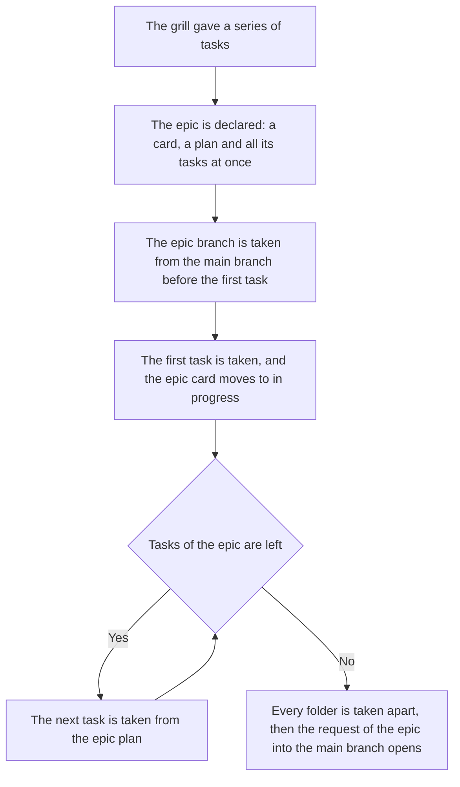

<!-- rt-kit v0.35.0 · rules/epic-flow.md · 08bc4dbfb4fd · правится надстройкой, не здесь -->

# Epics — how it works here

Rule under the law `docs/constitution/work-conduct.md`. The law says that the main branch takes the
whole or does not take it; here — how a series of tasks is held together as one epic. The course of
one task is rule `task-flow`, the end of a turn is `turn-conduct`, both under the same law.

## What it is called here

| In the law | Here |
| --- | --- |
| an epic — the unit of delivery | a card in the work queue with the epic label, a branch of its own from the main branch and a plan next to it. The plan holds the opportunity, the tasks and their order |
| the epic branch | `<КЛЮЧ>-<номер эпика>-<короткий-slug>`; the branches of its tasks are taken from it, and their PRs go into it |
| the epic plan | a record outside the task folder: the folder dies with the merge, the epic outlives it; the directory — in the rule's companion |
| who leads which epic | the table of assignments: a row for each working copy, written by the owner |

## Where it lives

In this tree — the table in `implementation.md` next to it. Paths live there, not here: the rule
travels between repositories, the layout does not, and a path named in the rule lies in the first
tree that keeps its code differently.

## Flow

The course of an epic from the series of tasks the grill gave to the request into the main branch.

## How the law applies here

- **Work begins with the epic, and a task outside one is not taken.** The main branch takes the
  whole or does not take it. Work outside an epic exists only by
  the owner's word about that work, said about that work.
- **The epic branch is taken before the first task of the epic, not with it.** Taken later, it
  leaves the first task on the main branch.
- **The epic card moves to in progress by the same turn that takes its first task.** The owner
  follows the epic by one card: left in place, it reads as never started.
- **The next task is taken from the epic plan, and the queue list is asked only where there is no
  epic.** A list of numbers does not tell someone else's epic from one's own.
- **Which epic this working copy leads is read from the table of assignments, and the owner writes
  it.** A card of the queue is not an order; a guard refuses every call that takes work until
  their word.
- **An epic is not closed by a sign confirmed by reading alone.** What is checkable by eye is
  called checked only with a command and its output.
- **The tasks of an epic are created all at once, by the same turn as the epic itself.** Creating
  them one at a time hides the volume.
- **A task of an epic is linked to the epic card as a sub-issue, not only named in the plan.** The
  board reads no text: without the link it looks like a task outside one. Closed tasks are linked.
- **The epic plan names how the branches of its tasks stand, on a par with their order.** Two
  arrangements: each branch from the epic branch, or a stack — each from the previous. The written
  arrangement binds whoever creates the branch.
- **The PR of the epic opens when its last folder is taken apart, and not a task earlier.** A folder
  left in the epic branch reaches the main branch with it. Until then nobody is offered the epic
  branch: its button means the whole epic.
- **The epic plan lies where it is found without the network and after the merge.** The card holds
  no task order, and the folder dies with the merge. What the owner names along the way is appended
  there by the turn that took it.

## What of the law is not here

Nothing compares the makeup of the tasks in the plan with the cards in the queue: the audit reads
the pair "card and plan", not the list. The order of the tasks and the arrangement of the branches
are prose of the plan, and no check reads them; they are held by whoever creates the next branch.

Nothing tells a sign of the end of an epic checked by a command from one confirmed by reading: both
leave the same line in the plan.

## Patterns

- `epic-flow-declare` — declaring an epic with its card, plan and tasks, then taking its branch.
