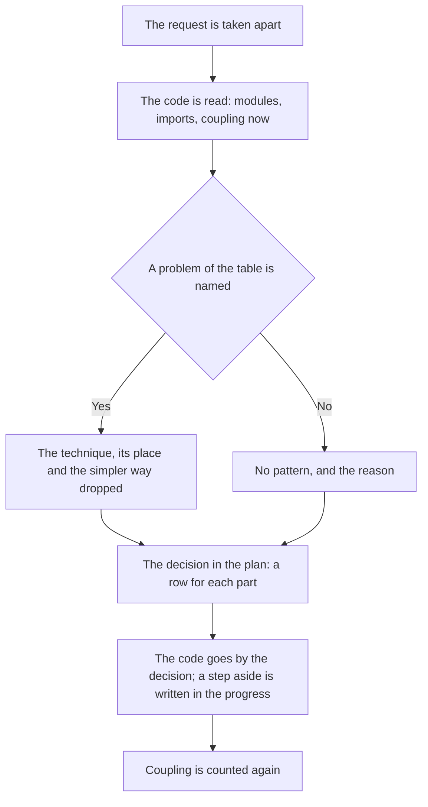

# Code design — how it works here — cold part

What the rule `code-design` does not carry into every edit: where it lives, what is not here and the
cases before and after.

Rule under the law `docs/constitution/code-structure.md`. The law says what must be true of a module;
here — by which technique that is reached.

## What it is called here

| In the law | Here |
| --- | --- |
| a duty of a module | one sentence about what it does, without «and» |
| the links of a module | coupling: incoming and outgoing imports, cycles, imports past the entry |
| what is shown outside | the symbols of the entry file, or the names a script's neighbours call |
| a change that stays | the diff names one module besides its tests and texts |

## Flow

## Where it lives

In this tree — the table in `implementation.md` next to it: the check of cycles, the check of
borders, the limit of the length. Paths live there, not here: the rule travels between repositories.

## Cases

### A cycle between sending, the report and the commands

- **Before.** The sending module held the numbers of a send and the reasons of its failure. The report
  imported the numbers from it, the commands imported the report, and the sending stood on the
  commands: three modules knew each other in a ring.
- **After.** The numbers and the reasons moved into a module of their own, about a hundred lines, with
  one duty: what a send left behind. The ring was gone without a late import, and the sending
  became shorter by the same lines. The technique is Indirection, and the duty is one sentence.

### A dozen guards with a copy of one condition

- **Before.** Every guard of delivery decided by its own `if` and composed its own refusal. One fact
  was judged in several files, and after an edit of one the others answered the old way.
- **After.** The guards collect facts, and the decision with its text is a row of one table read by
  one function. A new case adds a row; no guard is edited for it. The parsing of documents, needed by
  three of them, became one module with its own entry. The technique is a table of rows.

### Where no pattern is needed

A list of names appended by a ready function looks like a Decorator and is not one: nothing is wrapped
with the same interface. The plan says «no pattern», the place and the dropped way.

## Pitfalls

- **A pattern taken by its name, not by a problem.** The layers grow, and the problem stays.
- **A split by lines.** The length passes the limit, and one duty lies in two files that know each
  other.
- **A cycle broken by a late import.** The check is silent, the ring stays.
- **An entry imported by its own file.** The ring goes through the entry; the file is imported, and
  nothing moves out.
- **Coupling counted only after the edit.** There is no first number to compare with.
- **A helper exported «for the future».** The next reader relies on it, and the inside is shown.

## What of the law is not here

- **The names, the types, the cast, the deprecation mark and the length.** They are held by the rule
  `typescript-conventions`, where the tree has it.
- **The borders between libraries.** They are held by the rule `lib-layers`; what is taken instead of
  being written — by `reuse-first`.
- **That a module has one duty and a pattern has its problem.** No check reads that: it is seen by a
  reader of the plan and of the diff.
