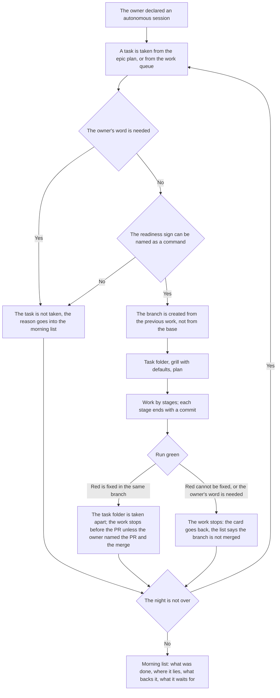

# Autonomous work — how it works here

Rule under the law `docs/constitution/autonomous-work.md`. The law says what must be true when the
owner is not around; here — what it is called in the tree and what changes in the ordinary course of
work. The course of work itself — rule `task-flow`, the end of a turn — `turn-conduct`, delivery —
`git-workflow`: an autonomous session does not cancel them, it narrows them.

**Cold part:** `pitfalls.md` next to it — traps already stepped on. Loaded on demand, not together
with the rule.

## What it is called here

| In the law | Here |
| --- | --- |
| an autonomous session | the owner's request to work without them, stated in words and with a time boundary; started by the command `/night` |
| a default instead of a question | a "Decisions" line in the grill: what was taken, the reason and the cost of a mistake |
| work visible from outside | pushing a branch, opening a PR, merging, publishing the package, sending cargo; moving a card on the work queue is not among them: the session moves it back itself, and nobody acts on it before morning |
| a chain | the branch of each next piece of work is created from the branch of the previous one |
| the morning list | a file the command `/night` creates and every closed work appends to: the work, the branch, what backs it, what it waits for; the last message gives it whole |
| the boundary and the allowance | two lines in the head of the list: `Автономно до: ГГГГ-ММ-ДДTЧЧ:ММ`, which the guards read, and `Разрешено:` with the owner's words |
| postponed work | a task that needs the owner's word: its state on the board does not move |

## Where it lives

In this tree — the table in `implementation.md` next to it: how an autonomous session is declared,
where the morning list is kept and what key the chain's tasks have. Paths live there, not here: the
rule travels between repositories, and each tree has its own layout.

## Flow

## How the law applies here

- **The session is started by the command `/night`, and the time boundary goes to it as an
  argument.** Assembled from memory, the night shows what was forgotten only in the morning. The
  command takes the boundary, raises this rule and the pattern, makes the checks that cost a whole
  night if met at three o'clock, and creates the file of the morning list. A night declared by words
  starts with the same steps, and a boundary that is an event is written as the latest moment the
  owner expects it: without that moment the guards take the night for day.
- **The command called without a boundary asks the owner for one and starts nothing.** They are
  still here at that minute; by morning there is nobody to ask, and a session without a boundary is
  work without an end.
- **The command does not repeat the order of the night.** It raises the rule and the pattern:
  rewritten into the command, the order would become a second source and diverge from the first
  silently.
- **The branch of the next work is created from the previous one, not from main.** The first — from
  the epic branch, or from main where the work has no epic; each next — from the tip of the
  previous: `git checkout -b <КЛЮЧ>-<номер>-<slug> <прошлая-ветка>`. They merge in turn from the
  bottom up, and each PR stands on the previous one. A night work stops in the state
  `папка-разобрана`, unless the owner named its push, PR and merge. A base that moved during the night — main or
  the epic branch — is merged into the previous branch locally before the next branch is created:
  a delivery check refuses a base without it, and the fix it names needs a push.
- **Nothing goes outside during the night except what the owner named when leaving.** No push, PR,
  merge, publishing or cargo send past their word: all of it is visible to others, and a person
  cancels it. Their word goes verbatim into the head of the morning list as the line `Разрешено:`,
  and each list line names the allowance it used. Cargo marks that need a merge wait for the merge.
- **The allowed night calls are rehearsed before the owner leaves, and none waits on a
  permission prompt.** A kind with a form that changes nothing is run twice with different data. A merge, a
  publication or a send is never rehearsed by doing it: the owner's own allow rule covers it. A call
  that prompts with no such rule leaves the allowance.
- **An interrupted call cancels that call, not the session.** The work goes on with the next step,
  and a turn of the night ends with neither a promise nor a question in text.
- **The order to work alone is not an approval.** No plan, mockup or look is approved by it, and it
  is never quoted in an approval record. On plan approval at night: a task whose code a guard holds
  until the plan is approved is postponed whole; one the guards let through goes, and the list names
  the approval it lacks.
- **An incident analysis is written at night at once.** It goes to the intake only if the owner
  named the send; otherwise the list names it.
- **A task that needs the owner's word is not taken at all.** Its state on the board does not move:
  a task taken and postponed halfway looks done, and the next session does not come back to it. A
  task that runs into the owner's word halfway stops the way unfixable red does.
- **A default is written where the owner's answer would have been written.** As a line in the grill:
  what was taken, why and what a mistake will cost. A silent default cannot be told from knowledge.
- **The readiness sign is named as a command before the stage begins.** The executor's look confirms
  nothing in an autonomous session: there is nobody to check it until morning.
- **A red run is fixed in the same branch, not postponed.** Postponed, it reaches the owner together
  with a branch that cannot be merged. Red that cannot be made green stops this work: its card goes
  back to its former column, its line in the list says the branch is not merged, and the next work
  branches from the last green branch of the chain — the stopped one leaves the merge order.
- **A guard's refusal is a work step, not the end of the session.** It names what was skipped; the
  skipped is done, and the work goes on. A refusal that demands an action visible from outside the
  owner did not name stops the work before that step, and the list names what it waits for. The
  turn-exit guard names a default instead of the owner's menu before the boundary. A call whose guard
  would open the owner's window is not made before it: the work waits, and the list names the call.
  Bypassing a guard stays forbidden in an autonomous session too.
- **The morning list is written along the way, not recalled at the end.** Each closed piece of work
  appends its line: the night is longer than the window. A broken night is resumed from the list
  file, which the command does not write over.

## What of the law is not here

Nothing checks that the session ended at its boundary or by the owner's word, and a queue emptied
earlier is not told from unfinished work: the list is completed, and the turn is held until the
scenario is over or the harness ends it. The turn-exit guard reads the boundary line only to name a
default instead of the owner's menu while it lies ahead; the guards that ask by their own window do
not read it, and a tree that has taught one of them names it in the companion. The ban on what is visible from outside past the
allowance, the chain's base, a written default and a readiness command named before the stage are
held by the rule, not by a guard: the push command is no different from the one made by day.

## Patterns

- `autonomous-work-run` — the ready-made night cycle: the chain of branches, writing a default, the
  morning list, handling a guard's refusal.
