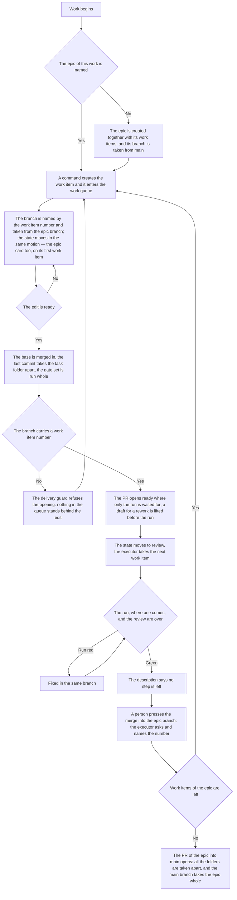

# Delivery — how it works here

Rule under the law `docs/constitution/delivery.md`. The law says what must be true; here — by which
technique it is held in a tree that lives in Azure DevOps. The organisation, the project, the
machine account and the commit scopes are this tree's, in `implementation.md` next to it: they
cannot be guessed and are never shared.

**Cold part:** `pitfalls.md` next to it — traps already stepped on. Loaded on demand, not together
with the rule.

## What it is called here

| In the law                   | Here                                                                                                                                                                                                                     |
| ---------------------------- | ------------------------------------------------------------------------------------------------------------------------------------------------------------------------------------------------------------------------ |
| main branch                  | `main`                                                                                                                                                                                                                   |
| epic                         | a work item of kind `Epic`, title `[<номер>] <Возможность>`, its work items are linked to it as children; a plan next to it: the order of tasks and how the branches stand                                                                |
| epic branch                  | `<номер эпика>-<короткий-slug>`, taken from `main`. Branches of its work items are taken from it, and their PRs go into it                                                                                               |
| PR of an epic                | PR into `main` from the epic branch; opens after all its work items are merged and their folders taken apart                                                                                                             |
| separate branch              | `<номер рабочего элемента>-<короткий-slug>`, taken from the epic branch; the form — in `implementation.md`. A name without a number (`feat/…`, `fix/…`) is legitimate locally: no PR opens from it                                                   |
| task                         | a work item of kind `Task` or `Bug`, title `[<номер>] <Что не так>`, assignee the machine account; the PR attaches at creation by the `--work-items` flag, a commit by the line `AB#<номер>`                             |
| work queue                   | the project's Azure Boards. A work item lands on the board by being created: the board shows the items of its area and iteration                                                                                         |
| task state in the work queue | the work item's `State` field: `New` when created, `Active` in progress, `Resolved` in review. The state set depends on the project process and is named in `implementation.md`; a closed task leaves the queue by merge |
| PR about a task              | PR title `[<номер>] <Что сделано>` — the work item's number and title turned into the done; commit type and scope stay out                                                                                               |
| discussion of an edit        | PR review: reviewer — the repository owner, assignee — the machine account, labels — the same as on the work item                                                                                                        |
| record of an edit            | `type(scope): description`, types `feat`, `fix`, `refactor`, `docs`, `style`, `test`, `chore`, `perf`; scopes: `implementation.md`                                                                                       |
| author of machine work       | a separate account; its name and the token's place — in `implementation.md`. The token lies outside the repository                                                                                                       |

## Where it lives

In this tree — the table in `implementation.md` next to it. Paths live there, not here: the rule
travels between repositories, the layout does not, and a path named in the rule lies in the first
tree that keeps its code differently.

## Flow

The flow from task to merge: where the guard stands, what moves the work queue column and how the
work ends.

## How the law applies here

- **A commit into the main branch is refused by the guard.** The guard looks for a commit call
  anywhere in the command and reads the current branch at launch, so a compound "create a branch and
  commit at once" is rejected whole: the branch does not exist yet at review.
- **A branch without a work item number opens no PR.** The delivery guard refuses `az repos pr
  create` from such a branch: locally it is legitimate, but an edit from it is a rollout with
  nothing behind it in the work queue. A work item is created, and the work moves to a branch with
  its number.
- **Work begins with the epic, and the branch of a work item is taken from the epic branch.** `git
  checkout -b <номер элемента>-<slug> <ветка эпика>`; from `main` only the epic branch itself is
  taken — a branch taken from `main` carries into it what the epic has not finished.
- **The PR of a work item has the epic branch as its base — `az repos pr create --target-branch
  <ветка эпика>`.** Opened into `main`, it leaves the epic branch a copy nobody merges. In a chain
  the base is the previous branch, lawful while it carries the epic branch.
- **The PR of an epic into the main branch opens after all its work items are merged and their
  folders are taken apart.** The merge button there means the whole epic, and there is nothing to
  press it for while one of them is still written.
- **The epic branch carries the plan of the epic and the merges of its work items, and no edits of
  its own.** An edit made in it goes into `main` unreviewed: nobody opens a PR from that branch to
  it.
- **The main branch is merged into the epic branch, and the epic branch into the branches of its
  work items — while the work runs, not before the hand-over.** The delivery guard refuses the
  opening until the tip of the base is an ancestor of the branch, and names the divergence as a
  commit count: otherwise the reviewer sees the edit mixed with someone else's, checked from a base
  that is gone.
- **A wave of branches off one epic branch is checked by a trial merge, not one by one:** each is
  green on its own, and they collide on what one branch cannot show.
- **The next work's branch is taken from the previous one while the chain is unbroken.** `git
  checkout -b <номер>-<slug> <предыдущая ветка>`; from the epic branch — only the chain's first
  work.
- **A PR in a chain has the previous branch as its base, not main.** `az repos pr create
  --target-branch <предыдущая ветка>` — otherwise the review shows the edit mixed with all under it.
  The base is retargeted before the lower one is completed — the calls are in the pattern `git-workflow-pr`.
- **A chain is merged bottom-up, and the order stands in every PR description.** Branch kinship is
  invisible in the list, and the line "stands on !<number>" is the only place it is read.
- **The lower branch of a chain does not rewrite history — neither `rebase` nor a force push.** The
  upper PR loses its diff with it. A lagging branch is fixed by merging its base in.
- **A divergence inside a chain is resolved by the one who branches.** Both edits are theirs; the
  owner resolving the same at merge time owns neither.
- **Unmet delivery conditions are named in one refusal.** The guard collects and prints them at
  once: everything unmet is known on the first call.
- **A condition known at the start of work is asked at the start.** Creating a branch refuses a base
  without the tip of the branch it stands on and a foreign signature email: at push time the fix
  costs more.
- **The base judged is the one named by the command, not the tip of the working copy.** A branch is
  also created straight from `origin/main`, and that command takes the base fresh; a base the tree
  knows nothing of is not judged.
- **A branch without a work item number gets no delivery conditions.** A local trial branch is
  legitimate, and it will not go to main.
- **A commit lands with its final content, and a later commit of the same branch does not correct
  it.** It is made after the check against the mockup, the sample and the measurement; what is not
  checked stays in the working tree. A third commit fixing the first shows the reviewer the miss
  instead of the work, and rewriting history hides the trace, not the cause.
- **A code edit is handed to a person by an open PR, not by a pushed branch.** A branch reaches no
  inbox; the PR opens in the turn the work is said handed over, and the reply names its number.
- **What is not ready to merge opens as a draft — `az repos pr create --draft true`.** The host
  itself locks a draft's complete button. A rework or an unanswered question goes as a draft, and
  the question is asked in the PR itself. The check pipeline does not start on a draft by default: a
  PR that waits only for the run opens ready, and a draft's silence is not taken for a green run.
- **A PR the pipeline does not wake for opens ready, without the draft flag.** Which target branches
  carry a build validation policy is read from the branch policies: where no run comes, a draft
  waits for nothing and costs a locked button and a second turn. The reviewer is set in the same
  turn.
- **What checks a PR whose base is not the main branch is asked before the first PR of an epic
  opens.** The pipeline either wakes for it as for one into main, or does not, and then the push
  gate is the only check behind the work — pattern `git-workflow-stack`.
- **`--hard` is not taken to drop a commit — that is `--soft`.** `reset --hard`, `checkout --
  <path>`, `restore <path>` and `clean -f` erase what is not committed. On a dirty tree the guard
  refuses and names the files; the bypass is `# discard: <reason>` in the command.
- **The working tree is emptied before the PR opens, not after.** `git status --porcelain` is asked
  in the same turn as the opening: what is uncommitted goes to the host by a commit before it, or
  is named. A push after the opening moves the tip past the green run the body names, and for that
  stretch the PR invites merging a tip nothing has checked.
- **A push into a branch that has an open PR is followed by rereading its body.** The statement
  about a green run names the tip by its sha, and moving the tip makes it false in silence: no check
  reads a PR body.
- **On remarks to a PR the person is asked whether to answer under them, and after a yes each one
  gets an answer.** Edits alone leave the discussion silent, and the person reads the whole diff
  again. The word holds for that PR, not for the next.
- **The draft is lifted by a separate call — `az repos pr update --id <номер> --draft false`.** With
  it the executor answers for readiness: the push gate passed, no rework left, the work matches the
  work item. Where a build validation stands on the target, the merge is asked after the green run,
  not in the lifting turn; where none stands, lifting and asking are one turn. A PR opened ready
  needs no such call.
- **The PR merge is pressed by a person, not by the work's executor.** The Complete button, `az
  repos pr update --status completed` and auto-complete set by the executor are equal. The executor
  merges their own PR only when a person said so about this PR; said about one, it does not carry to
  the next.
- **A created work item is confirmed by the work queue's answer, not by the creation command's
  output.** A work item can be created and never reach the board: the queue is asked by number, and
  the answer is read from its presence on the board, its state and its assignee.
- **The branch number and the PR title number are checked on the spot, the work item state — by the
  board.** The format is read from the command text and works offline; the second tier needs
  something to ask with, and without network or token it is skipped silently.
- **The state of a work item moves in the same motion as the work.** Branch created — the work item
  is in progress, PR opened — awaiting review; the move command does it, not a set of calls from
  memory.
- **The epic card moves by the same command, on the epic number, at two moments.** First work item
  taken — the epic is in progress; the PR of the epic into `main` opens — the epic awaits review.
  `npm run task:move -- <номер эпика> in-progress`. Left in the initial state while its work items
  merge, the epic reads as never started. The states of an `Epic` are its own and are named in
  `implementation.md` apart from the work item's.
- **A work item left in the initial state opens no PR.** By the work queue it reads as not taken,
  though the work is done and published. The tree names the initial state itself; unnamed — not
  judged.
- **The board holds work items, not PRs about them.** The link to the item is set at PR creation; a
  PR card has no state and never leaves the queue. The queue audit finds such cards, a line each.
- **A lagging state is found by the queue audit, not by eye.** The audit judges the state by the PR
  both ways: an open PR with the item not in review, and review with no open PR — both
  discrepancies. The moment a work item is taken into work it cannot see: the branch is not on the
  board.
- **A branch with an open PR lags behind its base silently.** The guard judges the base once — at
  opening; what merged into the base later a green run never sees. The lag is found by the work
  queue audit, which names it as a commit count.
- **Work items fixed by one edit are merged before the branch merge.** The second is closed as a
  duplicate, and the missing from it is added to the first. The law orders the second erased, and
  this is the second declared deviation: a work item here has a native "duplicate" link, deletion
  takes the edit history and attachments with it, and the number is not reused after it — a link to
  an erased item from someone else's commit leads into a void. After the merge there is no merging
  them: the branch went in, and it rolls back whole.
- **Work that one session cannot close is marked in two places, and they are audited.** The label on
  the board and the line about sessions with a handover in the epic plan say the same to two
  readers: the executor opens the card before the epic plan, and plans by the plan. One mark without
  the other lies silently, so the queue audit judges the pair both ways. Only what legitimately does
  not split is marked: a mark of volume grants no right to split.
- **A document goes in the same commit as the edit.** The bypass is the line `Docs-skip: <reason>`
  in the commit body; an empty reason is not accepted.
- **The commit subject is checked against the format on the spot.** A subject parsed by type and
  scope is read as a list, free text — only whole.
- **Before a push all linters are run, not one.** The code linter usually does not read style files
  at all; without a second run nothing checks the styling rules.
- **The build is in the set on a par with lint and unit tests.** The linter does not read types, and
  a type error in uncovered code lives until the merge.
- **On a machine with several runners, any path from the home directory is shared.** Install
  directory, container name, builder name and published port are per project. A temporary directory
  is not the answer: the package store lives there.
- **The push gate set is never narrower than the pipeline set.** A pipeline step with neither a line
  in the set nor a declared exclusion refuses the push: a warning reads as permission.
- **The final set before a push is read from the state review, not assembled in the head.** The "set
  before push" section prints it whole, naming what the default gave and the set did not take.
- **A push is sent only by the path the push guard stands on.** A terminal, a process or a script
  started outside the session carries the same command past the gate, unless the tree wired the
  git hook `pre-push`: then git runs the set there too. A send cut off by the session's end is
  asked of the host and repeated by the same path.
- **A review of a foreign branch starts with the gate set run on its tip.** Reading the diff misses
  what the set judges by the whole tree: a word, a file limit. A check that stands only on an edit,
  such as the wording one, is run over the changed texts apart. The output goes into the review,
  and a later push into that branch is run again.
- **Where neither the session's push guard nor the git hook fires, the set is run whole, as read at
  the minute of the run.** It is read from the state review or from the tree profile together with
  the package default it calls. A list from memory, from a copy made earlier or from the profile
  alone drops checks: the profile names the set, the task names only the work.
- **An exclusion reason naming a work item is judged on whether that work item is alive.** A dead
  number silently makes the exclusion perpetual.
- **The layout audit stands in the push gate set on a par with lint and the build.** An edit past
  the source piles up silently, and the audit is not in the pipeline.
- **After merging the base in, the check set is revised by what the branch now carries.** Checking
  by what the author edited means checking half: the branch answers whole.
- **The main branch is taken by the remote ref — in words and in actions.** The local one is
  yesterday's snapshot and silent about it: by it a merged branch counts as unmerged. Both sides of
  a comparison are taken from `origin/`.
- **A work item is bound to the PR at creation, not after.** `az repos pr create` takes
  `--work-items`; binding by a second command is bypassed silently when the token has no right to
  edit someone else's item, and the PR stays bound to nothing.
- **A merge with auto-complete does not replace the checks before a push.** Auto-complete sees only
  the pipeline, and the pipeline sees only what is pushed: a red branch occupies the work queue and
  looks ready for review.
- **The state set is taken from the project process, not assigned by the rule.** Agile, Scrum and
  Basic name the same three steps differently, and a move to a state the process lacks answers with
  a refusal on every work item in a row.
- **Guard scenarios set the git settings themselves, not take them from the machine.** Author, email
  and signature go as `-c` flags.

## What of the law is not here

This host has no task key, and the name form is built from the number alone. The law demands the
number be written the same everywhere — "key, hyphen, number" — and this is a deviation from it,
declared here: a work item number is unique across the whole project, and the host's native link
form — `AB#<номер>` — carries no key at all, and one attached to it breaks the linking of a commit
to the item. The `board.taskKey` setting a tree on this host does not set; the checks that look for
a key in the title judge the bare number here.

The delivery guard stands on the agent's commands, so it does not see a branch created by hand in
the editor: its name is held by memory. The requirement is no weaker for that — only no separate
check is made for it: work is recognised by the work item title and the PR, and that is audited for
everyone. The queue audit never judges the branch name: an open PR's branch cannot be renamed.

The guard does not move a work item to in progress: it does not edit the board — a board edit during
command review would fall with the connection and refuse the work instead of the miss. The move is
held by memory and by the hint the creation command prints. An item left in the initial state the
guard names at PR opening — that is, after it should have been moved; other state discrepancies the
queue audit finds. The epic card is held by memory alone: no guard reads its state at branch
creation, and the queue audit does not judge it.

The guard does not ask for a reviewer here: lifting the draft is an edit of the PR itself — the same
call as its other fields — and to a machine it cannot be told from other edits. This is held by the
vocabulary above, where the PR review is led by the reviewer, and by the memory of whoever lifts the
draft.

The freshness of the tip of the base the guard asks by the second tier — the same technique as the
task state: something to ask with — it asks; no network or access — it skips silently. The first
tier stays and works offline: the local ref answers the question "has the base lagged what already
lies in the tree", the remote one — "has the ref itself gone stale". Without the second tier the
guard's silence meant only the first and was read as the second.

The delivery guard reads the base of a PR from `--base` alone; here the flag is `--target-branch`.
Without a queue helper it judges the branch by `main`, with one it refuses a lawful PR into the epic
branch. Until the package reads the flag, the base and the draft-or-ready choice are the executor's.

A PR that waits only for the run opens ready, and the law keeps such work under a draft: a declared
deviation, the run does not start on a draft. Complete is then held only by a required build
validation.

## Patterns

- `git-workflow-commit` — work item, branch, commit and push as the machine account.
- `git-workflow-pr` — opening a PR, the draft and lifting it, the body, reviewer, binding to the
  item.
- `git-workflow-merge` — the base merged into the branch standing on it, the conflict resolved.
- `git-workflow-stack` — a chain of branches: branching from the previous, the base, the hand-over
  order.
