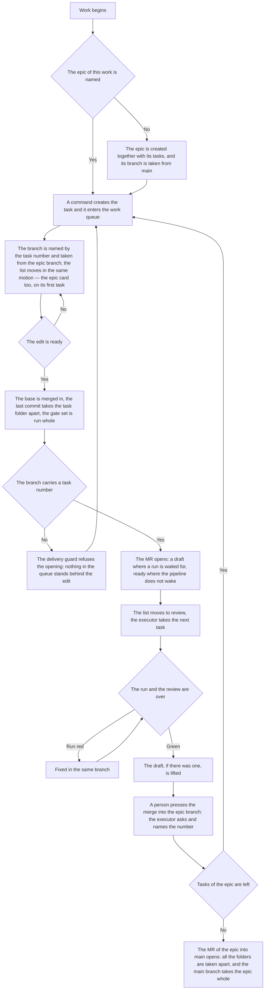

# Delivery — how it works here

Rule under the law `docs/constitution/delivery.md`. The law says what must be true; here — by which
technique it is held in a tree that lives on GitLab. The task key, the board address, the machine
account and the commit scopes are this tree's, in `implementation.md` next to it: they cannot be
guessed and are never shared.

**Cold part:** `pitfalls.md` next to it — traps already stepped on. Loaded on demand, not together
with the rule.

## What it is called here

| In the law                   | Here                                                                                                                                                     |
| ---------------------------- | -------------------------------------------------------------------------------------------------------------------------------------------------------- |
| main branch                  | `main`                                                                                                                                                   |
| epic                         | a project issue with the epic label, `[<КЛЮЧ>-<номер>] <Возможность>`, and a plan next to it: the order of tasks and how the branches stand              |
| epic branch                  | `<КЛЮЧ>-<номер эпика>-<короткий-slug>`, taken from `main`. Task branches are taken from it, and their MRs go into it                                     |
| PR of an epic                | MR into `main` from the epic branch; opens after all its tasks are merged and their folders taken apart                                                  |
| separate branch              | `<КЛЮЧ>-<номер задачи>-<короткий-slug>`, taken from the epic branch. A name without a number (`feat/…`, `fix/…`) is legitimate locally: no MR opens from it                          |
| task key                     | the tree's word for its tasks: `board.taskKey` in `.claude/rt-kit/checks.json`, named in `implementation.md` for the reader                              |
| task                         | a project issue `[<КЛЮЧ>-<номер>] <Что не так>`, assignee the machine account; attached MR: `Closes #<номер>` in its description                         |
| work queue                   | the project's Issue Board. A task lands on it by a list label, not by being created: the board shows what carries a label it knows                       |
| task state in the work queue | a board list backed by a label: created, in progress, in review. Label names in `implementation.md`; a closed task leaves by merge, not by the last list |
| PR about a task              | MR title `[<КЛЮЧ>-<номер>] <Что сделано>` — the task's number and title turned into the done; commit type and scope stay out                             |
| discussion of an edit        | MR review: reviewer — the project owner, assignee — the machine account, labels — the same as on the task                                                |
| record of an edit            | `type(scope): description`, types `feat`, `fix`, `refactor`, `docs`, `style`, `test`, `chore`, `perf`; scopes: `implementation.md`                       |
| author of machine work       | a separate account; its name and the token's place — in `implementation.md`. The token lies outside the repository                                       |

## Where it lives

In this tree — the table in `implementation.md` next to it. Paths live there, not here: the rule
travels between repositories, the layout does not, and a path named in the rule lies in the first
tree that keeps its code differently.

## Flow

The flow from task to merge: where the guard stands, what moves the work queue column and how the
work ends.

## How the law applies here

- **A commit into the main branch is refused by the guard.** The guard looks for a commit call
  anywhere in the command and reads the current branch at launch, so a compound "create a branch and
  commit at once" is rejected whole: the branch does not exist yet at review.
- **A branch without a task number opens no MR.** The delivery guard refuses `glab mr create` from
  such a branch: locally it is legitimate, but an edit from it is a rollout with nothing behind it
  in the work queue. A task is created, and the work moves to a branch with its number.
- **Work begins with the epic, and the branch of a task is taken from the epic branch.** `git
  checkout -b <КЛЮЧ>-<номер задачи>-<slug> <ветка эпика>`; from `main` only the epic branch itself
  is taken — a branch taken from `main` carries into it what the epic has not finished.
- **The MR of a task has the epic branch as its base — `glab mr create --target-branch <ветка
  эпика>`.** Opened into `main`, it leaves the epic branch a copy nobody merges. In a chain the base
  is the previous branch, lawful while it carries the epic branch.
- **The MR of an epic into the main branch opens after all its tasks are merged and their folders
  are taken apart.** The merge button there means the whole epic, and there is nothing to press it
  for while one of them is still written.
- **The epic branch carries the plan of the epic and the merges of its tasks, and no edits of its
  own.** An edit made in it goes into `main` unreviewed: nobody opens an MR from that branch to it.
- **The main branch is merged into the epic branch, and the epic branch into the branches of its
  tasks — while the work runs, not before the hand-over.** The delivery guard refuses the opening
  until the tip of the base is an ancestor of the branch, and names the divergence as a commit
  count: otherwise the reviewer sees the edit mixed with someone else's, checked from a base that is
  gone.
- **A wave of branches off one epic branch is checked by a trial merge, not one by one:** each is
  green on its own, and they collide on what one branch cannot show.
- **The next work's branch is taken from the previous one while the chain is unbroken.** `git
  checkout -b <КЛЮЧ>-<номер>-<slug> <предыдущая ветка>`; from the epic branch — only the chain's
  first work.
- **An MR in a chain has the previous branch as its base, not main.** `glab mr create
  --target-branch <предыдущая ветка>` — otherwise the review shows the edit mixed with all under it.
  The base is retargeted by the same motion that merges the lower one — the pattern
  `git-workflow-stack`.
- **A chain is merged bottom-up, and the order stands in every MR description.** Branch kinship is
  invisible in the list, and the line "stands on !<number>" is the only place it is read.
- **The lower branch of a chain does not rewrite history — neither `rebase` nor a force push.** The
  upper MR loses its diff with it. A lagging branch is fixed by merging its base in.
- **A divergence inside a chain is resolved by the one who branches.** Both edits are theirs; the
  owner resolving the same at merge time owns neither.
- **Unmet delivery conditions are named in one refusal.** The guard collects and prints them at
  once: everything unmet is known on the first call.
- **A condition known at the start of work is asked at the start.** Creating a branch refuses a base
  without the tip of the branch it stands on and a foreign signature email: at push time the fix
  costs more.
- **The base judged is the one named by the command, not the tip of the working copy.** A branch is
  also created straight from `origin/main`, and that command takes the base fresh; a base the tree
  knows nothing of is not judged.
- **A branch without a task number gets no delivery conditions.** A local trial branch is
  legitimate, and it will not go to main.
- **A commit lands with its final content, and a later commit of the same branch does not correct
  it.** It is made after the check against the mockup, the sample and the measurement; what is not
  checked stays in the working tree. A third commit fixing the first shows the reviewer the miss
  instead of the work, and rewriting history hides the trace, not the cause.
- **A code edit is handed to a person by an open MR, not by a pushed branch.** A branch reaches no
  inbox; the MR opens in the turn the work is said handed over, and the reply names its number.
- **What is not ready to merge opens as a draft — `glab mr create --draft`.** The host itself locks
  a draft's merge button, so the state "put up for viewing" and the state "may be merged" stop
  looking alike. Everything waiting for a pipeline run, a rework or an answer goes as a draft; the
  question is asked in the MR itself. The draft sign here is the `Draft:` prefix in the title, and
  it is edited together with it.
- **An MR the pipeline does not wake for opens ready, without the draft flag.** Which target
  branches it wakes for is read from the pipeline file: where no run comes, a draft waits for
  nothing and costs a locked button and a second turn. The reviewer is set in the same turn.
- **What checks an MR whose base is not the main branch is asked before the first MR of an epic
  opens.** The pipeline either wakes for it as for one into main, or does not, and then the push
  gate is the only check behind the work — pattern `git-workflow-stack`.
- **`--hard` is not taken to drop a commit — that is `--soft`.** `reset --hard`, `checkout --
  <path>`, `restore <path>` and `clean -f` erase what is not committed. On a dirty tree the guard
  refuses and names the files; the bypass is `# discard: <reason>` in the command.
- **The working tree is emptied before the MR opens, not after.** `git status --porcelain` is asked
  in the same turn as the opening: what is uncommitted goes to the host by a commit before it, or is
  named. A push after the opening moves the tip past the green run the description names, and for
  that stretch the MR invites merging a tip nothing has checked.
- **A push into a branch that has an open MR is followed by rereading its description.** The
  statement about a green run names the tip by its sha, and moving the tip makes it false in
  silence: no check reads an MR description.
- **On remarks to an MR the person is asked whether to answer under them, and after a yes each one
  gets an answer.** Edits alone leave the discussion silent, and the person reads the whole diff
  again. The word holds for that MR, not for the next.
- **The draft is lifted by a separate call — `glab mr update <номер> --ready`.** With it the
  executor answers for readiness: checks passed, no rework left, the work matches the task. Lifting
  the draft and asking to merge are one turn, and an MR opened ready needs no such call.
- **The MR merge is pressed by a person, not by the work's executor.** The button, `glab mr merge`
  and "Merge when pipeline succeeds" set by the executor are equal. The executor merges their own MR
  only when a person said so about this MR; said about one, it does not carry to the next.
- **The draft is not lifted while the MR has no review.** The delivery guard reads the requested
  reviewer and the review left: a lifted draft reads as "may be merged", and there is nobody to
  merge. Earlier than this turn there is nowhere to ask — before the MR opens there is no reviewer
  at all. Only a request and a review not from the author count as review: a review of oneself is no
  review. A call without a number is judged too — the client then takes the MR of the current
  branch, and one space would lift the requirement; returning an MR to draft gets no requirement.
- **A created task is confirmed by the work queue's answer, not by the creation command's output.**
  A task can be created and never reach the board: the queue is asked by number, and the answer is
  read from its presence on the board, its list and its assignee.
- **The branch number and the MR title number are checked on the spot, the task state — by the
  board.** The format is read from the command text and works offline; the second tier needs
  something to ask with, and without network or token it is skipped silently.
- **The list of a task moves in the same motion as the work.** Branch created — the task is in
  progress, MR opened — awaiting review; the move command does it, not a set of calls from memory.
- **The epic card moves by the same command, on the epic number, at two moments.** First task taken
  — the epic is in progress; the MR of the epic into `main` opens — the epic awaits review. `npm run
  task:move -- <номер эпика> in-progress`. Left in the first list while its tasks merge, the epic
  reads as never started.
- **A task left in the first list opens no MR.** By the work queue it reads as not taken, though the
  work is done and published. The tree names the first list itself; unnamed — not judged.
- **The board holds tasks, not MRs about them.** The board shows what is done and what is left; an
  MR answers another question — how exactly it was done — and opens from the task, where the link to
  it stands by itself. An MR card lives its own life: it has no list label, never leaves the queue
  and stays in it after the merge forever. Here it is created more easily than anywhere: the board
  is assembled by labels, and a list label put on an MR makes it a card at once. The queue audit
  finds such cards, a line each.
- **A lagging list is found by the queue audit, not by eye.** The audit judges the list by the MR
  both ways: an open MR with the task not in review, and review with no open MR — both
  discrepancies. The moment a task is taken into work it cannot see: the branch is not on the board.
- **A branch with an open MR lags behind its base silently.** The guard judges the base once — at
  opening; what merged into the base later a green run never sees. The lag is found by the work
  queue audit, which names it as a commit count.
- **Tasks fixed by one edit are merged before the branch merge.** The second is closed as a
  duplicate with a link to the one that absorbed it, and the missing from it is added to the first.
  The law orders the second erased — here that is a declared deviation: the host does not let a task
  be erased at all, and its number stays in history, so a link from someone else's commit leads to a
  closed task, not into a void. After the merge there is no merging them: the branch went in, and it
  rolls back whole.
- **Work that one session cannot close is marked in two places, and they are audited.** The label on
  the board and the line about sessions with a handover in the epic plan say the same to two
  readers: the executor opens the card before the epic plan, and plans by the plan. One mark without
  the other lies silently, so the queue audit judges the pair both ways. Only what legitimately does
  not split is marked: a mark of volume grants no right to split.
- **A document goes in the same commit as the edit.** The bypass is the line `Docs-skip: <reason>`
  in the commit body; an empty reason is not accepted.
- **The commit subject is checked against the format on the spot.** A subject parsed by type and
  scope is read as a list, free text — only whole.
- **Before a push all linters are run, not one.** The code linter usually does not read style files
  at all; without a second run nothing checks the styling rules.
- **The build is in the set on a par with lint and unit tests.** The linter does not read types, and
  a type error in uncovered code lives until the merge.
- **On a machine with several runners, any path from the home directory is shared.** Install
  directory, container name, builder name and published port are per project. A temporary directory
  is not the answer: the package store lives there.
- **The push gate set is never narrower than the pipeline set.** A pipeline step with neither a line
  in the set nor a declared exclusion refuses the push: a warning reads as permission.
- **The final set before a push is read from the state review, not assembled in the head.** The "set
  before push" section prints it whole, naming what the default gave and the set did not take.
- **A push is sent only by the path the push guard stands on.** A terminal, a process or a script
  started outside the session carries the same command past the gate, unless the tree wired the
  git hook `pre-push`: then git runs the set there too. A send cut off by the session's end is
  asked of the host and repeated by the same path.
- **A review of a foreign branch starts with the gate set run on its tip.** Reading the diff misses
  what the set judges by the whole tree: a word, a file limit. A check that stands only on an edit,
  such as the wording one, is run over the changed texts apart. The output goes into the review,
  and a later push into that branch is run again.
- **Where neither the session's push guard nor the git hook fires, the set is run whole, as read at
  the minute of the run.** It is read from the state review or from the tree profile together with
  the package default it calls. A list from memory, from a copy made earlier or from the profile
  alone drops checks: the profile names the set, the task names only the work.
- **An exclusion reason naming a task is judged on whether that task is alive.** A dead number
  silently makes the exclusion perpetual.
- **The layout audit stands in the push gate set on a par with lint and the build.** An edit past
  the source piles up silently, and the audit is not in the pipeline.
- **After merging the base in, the check set is revised by what the branch now carries.** Checking
  by what the author edited means checking half: the branch answers whole.
- **The main branch is taken by the remote ref — in words and in actions.** The local one is
  yesterday's snapshot and silent about it: by it a merged branch counts as unmerged. Both sides of
  a comparison are taken from `origin/`.
- **A merge by the "Merge when pipeline succeeds" button does not replace the checks before a
  push.** The pipeline sees only what is already pushed, and a pushed red branch occupies the work
  queue and looks ready for review.
- **MR labels and assignee are set at creation, not by an edit after.** `glab mr create` takes them
  as flags; editing an open MR with a second command is bypassed silently when the machine account's
  token does not see the project whole.
- **A task is moved across lists by editing its labels.** The board's lists are labels: a move that
  did not remove the previous label leaves the task in two lists at once, and the queue reads wrong.
- **Guard scenarios set the git settings themselves, not take them from the machine.** Author, email
  and signature go as `-c` flags.

## What of the law is not here

The delivery guard stands on the agent's commands, so it does not see a branch created by hand in
the editor: its name is held by memory. The requirement is no weaker for that — only no separate
check is made for it: work is recognised by the task title and the MR, and that is audited for
everyone. The queue audit never judges the branch name: an open MR's branch cannot be renamed.

The guard does not move a task to in progress: it does not edit the board — a board edit during
command review would fall with the connection and refuse the work instead of the miss. The move is
held by memory and by the hint the task creation command prints. A task left in the first list the
guard names at MR opening — that is, after it should have been moved; other list discrepancies the
queue audit finds. The epic card is held by memory alone: no guard reads its list at branch
creation, and the queue audit does not judge it.

The freshness of the tip of the base the guard asks by the second tier — the same technique as the
task state: something to ask with — it asks; no network or access — it skips silently. The first
tier stays and works offline: the local ref answers the question "has the base lagged what already
lies in the tree", the remote one — "has the ref itself gone stale". Without the second tier the
guard's silence meant only the first and was read as the second.

The delivery guard reads the base of an MR from the flag `--base` alone, and here the flag is
`--target-branch`. Without a queue helper of the tree it judges the branch by `main`; with one it
refuses a lawful MR into the epic branch. Until the package reads this flag, the base from the epic
branch and the choice between a draft and a ready MR are held by the executor.

## Patterns

- `git-workflow-commit` — task, branch, commit and push as the machine account.
- `git-workflow-pr` — opening an MR, the draft and lifting it, the description, reviewer, labels,
  state.
- `git-workflow-merge` — the base merged into the branch standing on it, the conflict resolved.
- `git-workflow-stack` — a chain of branches: branching from the previous, the base, the hand-over
  order.
