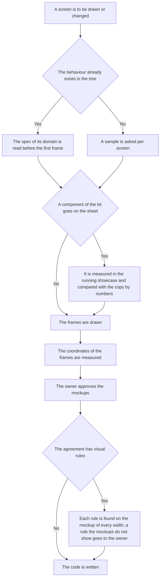

# Mockups — how it works here

Rule under the law `docs/constitution/mockups.md`. The law says what the owner must see before
the code is written; here — what it is called in this tree, where it lives and what is not checked.

## What it is called here

| In the law                          | Here                                                                         |
| ----------------------------------- | ---------------------------------------------------------------------------- |
| mockup                              | a frame on a sheet of the design tool                                        |
| the screen the mockup draws         | the page or panel in the application that carries the same name              |
| the description of the behaviour    | the domain spec in `docs/specs/<domain>/`                                    |
| the agreement                       | the product agreement of the task, `docs/specs/<domain>/proposed/<feature>/` |
| approved                            | shown to the owner and accepted in their words                               |

## Where it lives

In this tree — the table in `implementation.md` next to it. Paths live there, not here: the rule
travels between repositories, the layout does not, and a path named in the rule lies in the
first tree that keeps its code differently.

## Flow

The flow of a mockup from the first frame to the code: what is read before drawing, what is
measured before showing, and what is checked before work starts by the agreement.

## How the law applies here

- **A kit component on a design-tool sheet is a copy of the kit, and the copy drifts.** The source
  of look is the kit's styles in code. Before a component from the sheet goes into a mockup, it is
  measured in the running showcase, and its sizes, alignment and controls are compared with the
  bounds of the copy's nodes by numbers. Reading the styles does not show what the layout computes:
  the height of a row, where unselected items sit, a control that replaces an icon. A divergence is
  a question to the owner, and the answer is fixed once in the copy.
- **A mockup of behaviour the tree already has starts with reading the spec of its domain.** A
  screen in a design tool looks like work without code, so exploration stops at the sheet of earlier
  mockups. How a payment is taken, what a window asks and which fields a form holds are already
  described by the spec and carried out by code. The spec is read before the first frame, and the
  sample question is asked per screen: one sheet named as the sample of the whole set leaves the
  other screens without one.
- **The agreement is checked against the approved mockups before work by it.** Every visual rule of
  the agreement is found on the mockup of each width. A rule the mockups do not show goes to the
  owner as a question. Found after the code, it costs a code edit and an agreement edit together.
- **A mockup is measured by node coordinates before it is shown.** The technique is the pattern
  `mockups-measure`.
- **A design-tool call asks the rules gate for this rule,** like the browser driver does for its
  own: without that the measurement pattern stays unread for the whole mockup task.

## What of the law is not here

Nothing checks that a mockup matches the screen it draws or that the owner approved it: both live
outside the tree, in the design tool and in the owner's words. The checks above are held by reading.

## Patterns

- `mockups-measure` — reading the bounds of frames and buttons in one call and what the numbers
  mean.
